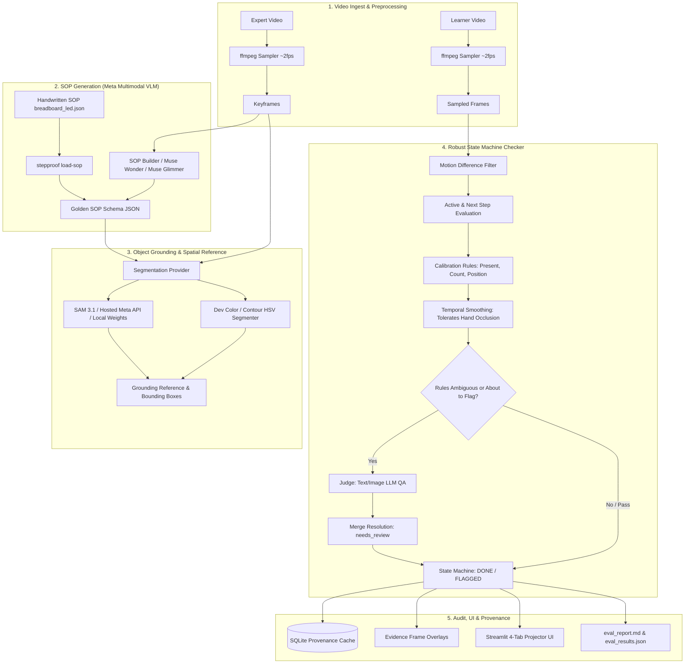

# StepProof 

> **Offline video-to-SOP generation and learner step verification engine with visual evidence.**  
> Built for the **Meta AI Developer Hackathon 2026**.

---

## What is StepProof?

StepProof turns a single **expert video demonstration** of a manual task into a structured Standard Operating Procedure (**SOP**) with discrete steps, target objects, expected visual end-states, and validation rules. It then analyzes a **learner's execution video**, validating physical progress and flagging **skipped**, **wrong/failed**, or **out-of-order** steps with annotated keyframe evidence.

StepProof is designed around a **free-first, Meta-compliant architecture**:
1. **Develop for Free**: Run offline with OpenCV mock segmenters and deterministic mock LLMs or local vision models (Ollama / Groq) with **zero API keys and zero cost**.
2. **Swap to Meta Models for Submission**: Seamlessly plug in **SAM 3.1** (local weights or Meta Model API) and **Muse Glimmer / Muse Wonder / Muse Spark** behind swappable provider interfaces.
3. **Meta Compliance Enforcement**: A strict compliance guard (`STEPPROOF_REQUIRE_META=1`) guarantees that all model inferences, cached results, and generated reports originate from official Meta models—preventing accidental silent fallback to non-Meta models.

---

##  Architecture & Pipeline



### Meta Models Used & Roles
- **SAM 3.1** (`sam-3.1` via Meta Model API or local `facebookresearch/sam3`): Pixel-accurate promptable segmentation and bounding box detection for parts (resistors, LEDs, jumper wires, blocks).
- **Muse Wonder 1.0** (`muse-wonder-1.0` via Meta Model API): Multimodal reasoning engine for procedural understanding and SOP rule synthesis from demonstration video.
- **Muse Spark 1.3** (`muse-spark-1.3`): Fast agentic judge model for ambiguous step resolution and verification.
- **Muse Glimmer 30B** (`meta/muse-glimmer-30b`): Distilled open-weights model for local / on-premise execution (when local weights are loaded).
- **Dev Stand-ins (Strictly Non-Meta, `meta_compliant=false`)**: Groq text-only Llama (`llama-3.3-70b-versatile`) and HSV color segmenter for rapid zero-cost offline development. Refused whenever `STEPPROOF_REQUIRE_META=1`.

---

##  Prerequisites

- **Python 3.11+**
- **ffmpeg** (system executable): StepProof uses `ffmpeg` for video decoding, downsampling, and keyframe extraction.
  ```bash
  # Linux (Ubuntu / Debian)
  sudo apt update && sudo apt install -y ffmpeg

  # macOS
  brew install ffmpeg
  ```
  *Note:* StepProof asserts `ffmpeg` presence at startup and raises a clear runtime error if it is missing from `PATH`.

---

##  Quick Start (Zero API Keys Required)

StepProof is ready to run immediately using synthetic demo footage and offline mock providers.

### 1. Install & Build Environment
```bash
make install
```
This initializes a Python 3.11 virtual environment (`.venv`), upgrades `pip`, and installs all dependencies in editable mode.

### 2. Run Test Suite
```bash
make test
```
Runs 48 unit and integration tests covering schema validation, SQLite cache modes, rule evaluation state machines, provider factory, and CLI execution.

### 3. Run Verification Demo
```bash
make demo
```
This single command:
1. Generates synthetic expert and learner demonstration videos (`expert.mp4`, `learner_correct.mp4`, `learner_skipped.mp4`, `learner_wrong_part.mp4`, `learner_out_of_order.mp4`).
2. Extracts and saves a golden SOP (`data/outputs/demo_sop.json`).
3. Grounds physical objects using the color/contour segmenter and generates reference overlays (`data/outputs/grounding/`).
4. Runs verification across all learner test videos, catching and flagging the staged errors.
5. Produces an audit report at `data/outputs/runs/skipped/report.md`.

### 4. Replay from Cache (Zero Network)
```bash
make demo-cached
```
Replays previously verified runs strictly from the SQLite cache (`STEPPROOF_MODE=cache_only`), guaranteeing deterministic execution with no model calls or external network requests.

### 5. Launch Streamlit UI
```bash
make app
```
Opens the interactive 4-tab dashboard at `http://localhost:8501`:
- **Tab 0 (Demo Mode)**: Projector-friendly presentation view with large fonts showing expert demonstration, golden SOP, clean baseline execution, and prominent faulty execution alert with visual evidence overlays.
- **Tab 1 (Build SOP)**: Select expert video, trigger frame extraction, inspect golden SOP checklist, and generate SAM grounding overlays.
- **Tab 2 (Check Run)**: Select learner video (correct, skipped, wrong part, out-of-order), trigger verification, view live status ticking (`DONE` vs `FLAGGED`), inspect evidence frame callouts with overlays, and review failed rules with model explanations.
- **Tab 3 (Report & Audit)**: Browse previous runs, inspect model provenance badges (`🟢 Meta model` vs `⚪ Dev stand-in`), examine flagged step evidence, and download `report.md` / `report.json`.

---

##  Verification Semantics & Flag Types

StepProof implements a rigorous step state machine. Each step receives a primary `flag_type` and optional `secondary_flag_type`:

| Primary Flag | Definition | Decision Logic |
| :--- | :--- | :--- |
| `none` | **Step Passed** | All step rules satisfied in consecutive sampled frames. |
| `skipped` | **Step Skipped** | Evidence for a subsequent step appeared, but this step was never completed. |
| `out_of_order` | **Out-of-Order** | Step was completed, but at a timestamp after a later step did. |
| `wrong` | **Wrong Part / Placement** | Failed rule detected during step execution (e.g. unexpected object placed, count mismatch, bounds violation). |
| `needs_review` | **Manual Review** | Rule checks passed but multimodal judge flagged inconsistency with confidence $\ge 0.85$. |

---

##  Meta Model API & SAM 3.1 Integration

> [!IMPORTANT]
> **Meta Model Run Status**: *Meta model run pending.*  
> Currently verified and tested with Dev stand-in (Groq Llama / OpenCV mock). Final live Meta model runs are generated strictly through run manifests evaluated with `STEPPROOF_REQUIRE_META=1`.

StepProof supports direct integration with Meta's developer platform (`https://api.meta.ai/v1`).

### Meta Model IDs (Planned & Configured)
- **Multimodal LLM / VLM**:
  - `muse-wonder-1.0` (Primary reasoning / verification model)
  - `muse-spark-1.3` (Fast agentic model)
  - `meta/muse-glimmer-30b` (Distilled open model)
- **Segmentation**:
  - `sam-3.1` (Hosted SAM 3.1 via Meta Model API)
  - `facebookresearch/sam3` (Local weights in fp16, batch size 1, targeting ~4 GB VRAM)

### Configuring `.env` for Meta API
Copy `.env.example` to `.env`:
```bash
cp .env.example .env
```
Set the following variables:
```bash
# Meta API Credentials
META_API_KEY=your_meta_api_key_here
LLM_API_KEY=your_meta_api_key_here
LLM_BASE_URL=https://api.meta.ai/v1

# Providers
STEPPROOF_LLM=openai_compat
LLM_MODEL=muse-wonder-1.0
LLM_API_STYLE=responses  # Uses Meta's /v1/responses format

STEPPROOF_SEG=meta_api   # Uses hosted SAM 3.1
```

### Running Smoke Tests
Verify connectivity and payload compatibility with zero risk:
```bash
# Smoke test Meta Model API (text request + single image prompt)
.venv/bin/python scripts/smoke_meta.py

# Smoke test Hosted SAM 3.1 (streams special tokens and decodes raster masks)
.venv/bin/python scripts/smoke_sam.py
```
> [!NOTE]
> Smoke scripts read exclusively from environment variables and **never print or log API keys**.

### Local SAM 3.1 Option
If you have local SAM 3.1 weights:
1. Place weights in `weights/sam3.1/` (gitignored).
2. Set `STEPPROOF_SEG=local_sam` in `.env`.
3. If weights are absent, StepProof gracefully detects their absence and provides clear instructions without downloading or redistributing proprietary weights.

---

## Threshold Calibration & Batch Evaluation

### 1. Calibrate Object Evidence
Tune per-object detection thresholds against reference footage before production runs:
```bash
stepproof calibrate data/expert/expert.mp4 --sop data/outputs/demo_sop.json
```
Prints per-step evidence statistics (detected frame count, minimum/average/maximum mask area in pixels, confidence distribution) and recommended thresholds for `calibration.yaml`:
```yaml
objects:
  red block:
    min_area_px: 1500
    min_confidence: 0.85
    expected_count: 1
    position_tolerance_px: 50
```

### 2. Batch Evaluation Suite
Run automated evaluation over benchmark manifests:
```bash
stepproof eval manifests/synthetic_manifest.yaml --out eval_report.md
```
Outputs an executive summary table and generates `eval_report.md`:
- **Scenario Pass / Fail status**
- **Correct-run False Alarm rate**
- **Detection Rate over staged errors** (100% on synthetic benchmark)
- **Average step latency**
- **Estimated inference cost per run**

Template manifest for custom real footage is available at `manifests/real_footage_template.yaml`.

#### Latest Synthetic Benchmark Results (`eval_report.md` - Synthetic Data)

> [!NOTE]
> **Data source**: `synthetic` (Colored block assembly simulation). Provenance: `⚪ Dev stand-in (mock)`. Meta model evaluation on real breadboard footage is pending live run execution.

| Metric | Measured Value | Benchmark Target | Status |
| :--- | :--- | :--- | :--- |
| **Correct-Run False Alarms** | 0 | 0 | 0 False Alarms |
| **Detection Rate (Staged Errors)** | 100.0% (3/3) | 100% | 100% Detected |
| **Average Latency Per Step** | 0.031s | < 0.500s (mock) | Low Latency |
| **Estimated Cost Per Run** | $0.000000 USD | < $0.05 | Zero Spend |

| Scenario Name | Result | Expected | Observed Flags & Types | Latency / Step |
| :--- | :---: | :---: | :---: | :---: |
| **Correct Sequence Execution** | ✅ PASS | None | None (`none`) | 0.026s |
| **Step 2 Skipped (Missing Green Block)** | ✅ PASS | Step 2 | Step 2 (`skipped`) | 0.034s |
| **Step 2 Wrong Part (Purple Block)** | ✅ PASS | Step 2 | Step 2 (`wrong`) | 0.036s |
| **Step 2 Out-of-Order (Blue Placed First)** | ✅ PASS | Step 2 | Step 2 (`out_of_order`) | 0.028s |

---

##  Robustness, Budget Guards & Cost Tracking

StepProof prevents runaway API spend and inference failures:
- **Cost Tracking**: Tracks real token counts (`input_tokens`, `output_tokens`) from API responses, recording exact costs in provenance records using configurable prices from [`prices.yaml`](prices.yaml) (defaults to $0.00).
- **Budget Guards**: Enforces `MAX_REQUESTS_PER_RUN` (default: 50) and `MAX_COST_USD` (default: $5.00), halting runs before budget overruns.
- **Image Budget**: Limits frames sent per LLM call via `MAX_IMAGES_PER_REQUEST` (default: 20).
- **Automatic JSON Repair**: Automatically repairs unclosed brackets, markdown fences, and trailing commas via [`src/stepproof/json_repair.py`](src/stepproof/json_repair.py) before triggering retries.
- **Versioned Prompts**: All prompt templates reside in `src/stepproof/prompts/` (`sop_v1.txt`, `judge_v1.txt`) and are integrated directly into deterministic cache keys.

---

##  Meta Compliance Enforcement (`make final` & `make final-run`)

The hackathon compliance guard ensures no mock or dev stand-in results are mistakenly submitted:
```bash
make final
```
When `STEPPROOF_REQUIRE_META=1` is active:
1. Provider factory refuses mock, Groq, or Ollama dev models.
2. Cache layer refuses cached records where `meta_compliant=False`.
3. If non-Meta results are detected, it **fails loudly** with an explicit compliance refusal banner:
   ```
   ================================================================================
   ❌ STEPPROOF FINAL COMPLIANCE REFUSAL:
   STEPPROOF_REQUIRE_META=1 is set. Cached results were generated with dev stand-in
   (mock) models. Non-Meta model outputs are strictly refused for compliance.
   To pass 'make final', configure real Meta credentials (api.meta.ai or local SAM).
   ================================================================================
   ```

To execute the full real manifest under strict Meta compliance:
```bash
make final-run
```

To run non-destructive smoke tests verifying connectivity and special token parsing against live Meta endpoints:
```bash
make meta-smoke
```

---

##  Complete CLI Command Reference

```bash
# 1. Build SOP from expert demonstration video
stepproof build-sop <video.mp4> --out <sop.json> [--mode live|cache_only|refresh]

# 2. Ground physical objects on keyframes
stepproof ground <video.mp4> --sop <sop.json> --out-dir <output_dir>

# 3. Check learner video against golden SOP
stepproof check <learner.mp4> --sop <sop.json> --out-dir <run_dir> [--mode live|cache_only|refresh]

# 4. Calibrate object thresholds
stepproof calibrate <video.mp4> --sop <sop.json>

# 5. Run batch evaluation against manifest
stepproof eval <manifest.yaml> [--out eval_report.md]

# 6. Export or print Markdown verification report
stepproof report <run_dir> [--out report.md]

# 7. Replay run from cache with Meta compliance check
stepproof replay <run_dir> [--require-meta]

# 8. Check manifest footage health (duration, exposure, camera shake)
stepproof doctor <manifest.yaml>

# 9. Detailed segmentation inspection and tuning timeline
stepproof inspect <video.mp4> --sop <sop.json> [--out <output_dir>]

# 10. Propose step timing windows from video
stepproof windows <video.mp4> --sop <sop.json> [--out <windows.yaml>]
```

---

##  Repository Layout

```
stepproof/
├── pyproject.toml                  # Project packaging, CLI scripts, dependencies
├── Makefile                        # Targets: install, test, lint, app, demo, demo-cached, final, final-run, meta-smoke, preflight
├── .env.example                    # Environment variable template with planned Meta model IDs
├── prices.yaml                     # Model pricing per 1k tokens for cost tracking
├── calibration.yaml                # Per-object segmentation thresholds
├── manifests/
│   ├── synthetic_manifest.yaml     # Benchmark manifest for synthetic runs
│   ├── real_footage.yaml           # Manifest for real footage evaluations
│   └── real_footage_template.yaml  # Template for real footage evaluations
├── scripts/
│   ├── make_synthetic_video.py     # Synthetic video dataset generator
│   ├── smoke_meta.py               # Meta Model API LLM smoke test
│   ├── smoke_sam.py                # Hosted SAM 3.1 smoke test
│   ├── meta_eval.py                # Interactive budget confirmation and Meta run driver
│   └── preflight.py                # Submission readiness quality gate
├── src/stepproof/
│   ├── __main__.py                 # CLI commands (build-sop, ground, check, calibrate, eval, report, replay, doctor, inspect, windows)
│   ├── config.py                   # Pydantic environment configuration & budget limits
│   ├── schemas.py                  # Pydantic schemas (SOP, Check, Evidence, Verdict, Report)
│   ├── provenance.py               # ProvenanceRecord tracking & Meta compliance guards
│   ├── pricing.py                  # Token pricing and cost calculations
│   ├── json_repair.py              # Robust JSON repair utility
│   ├── calibration.py              # Evidence profiler and threshold tuner
│   ├── evaluation.py               # Batch evaluation engine & Markdown report generator
│   ├── cache.py                    # SQLite cache (live, cache_only, refresh modes)
│   ├── ingest/
│   │   └── sampler.py              # ffmpeg downsampling (~2 fps) + scene-change detection
│   ├── prompts/
│   │   ├── sop_v1.txt              # SOP extraction system prompt
│   │   └── judge_v1.txt            # Multimodal verification judge prompt
│   ├── providers/
│   │   ├── base.py                 # LLMProvider & SegmentationProvider interfaces
│   │   ├── factory.py              # Factory with require_meta compliance check
│   │   ├── llm_mock.py             # Deterministic mock LLM
│   │   ├── llm_openai_compat.py    # OpenAI/Meta client (chat & responses styles, backoff, budget)
│   │   ├── seg_mock.py             # OpenCV color/contour mock segmenter
│   │   ├── seg_local_sam.py        # Local SAM 3.1 (fp16, batch size 1) with missing weights guard
│   │   └── seg_meta_api.py         # Official hosted SAM 3.1 client with meta-sam-parser
│   ├── pipeline/
│   │   ├── sop_builder.py          # SOP generation and cache integration
│   │   ├── grounding.py            # Object grounding & reference overlay generator
│   │   ├── checker.py              # Step state machine, disambiguation & visual overlays
│   │   └── report.py               # RunReport export & Markdown report generator
│   └── app/
│       └── streamlit_app.py        # 4-tab interactive web dashboard with flagged step audit
└── tests/                          # 48 unit & integration tests (100% offline)
```

---

##  License
MIT License.
